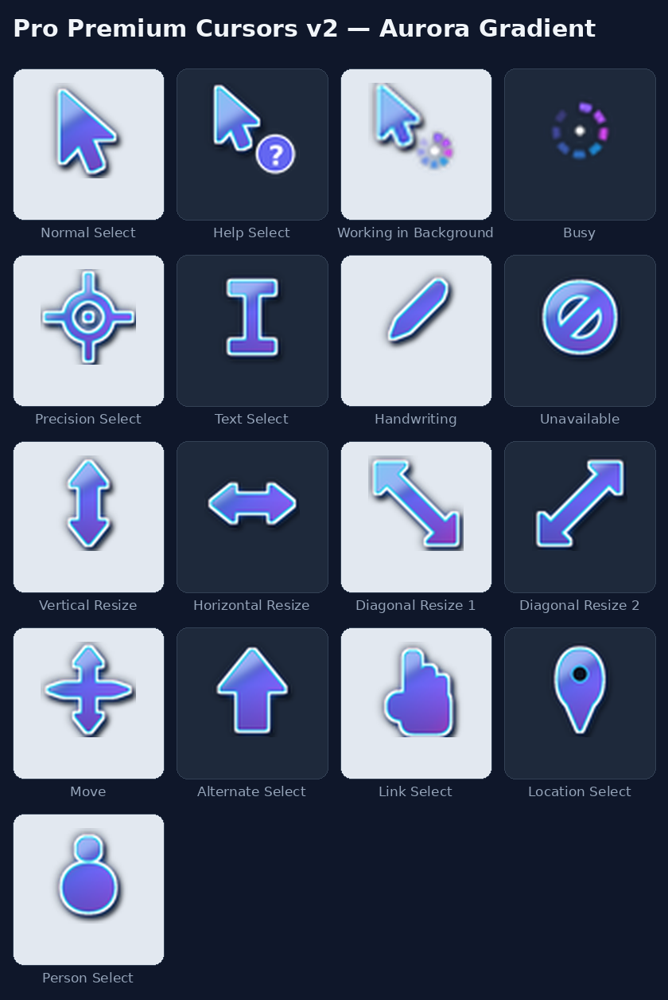

<div align="center">


# 🖱️ Pro Premium Cursors

### *Your mouse, but make it premium.*

**A complete premium Windows cursor scheme — all 17 pointers, redesigned.**
**Dark navy glass fill · crisp white border · cyan glow · buttery animated spinners.**

<br/>


<br/>

[](https://github.com/akhilesh2412/PremiumCursors/releases/latest)
[](https://github.com/akhilesh2412/PremiumCursors)

</div>

---

## 👀 Preview — The Full Set

<div align="center">

</div>

Every single Windows pointer is covered — no half-done pack where half the cursors stay default:

| | | | |
| --- | --- | --- | --- |
| Normal Select | Help Select | Working in Background *(animated)* | Busy *(animated)* |
| Precision Select | Text Select | Handwriting | Unavailable |
| Vertical Resize | Horizontal Resize | Diagonal Resize 1 | Diagonal Resize 2 |
| Move | Alternate Select | Link Select | Location Select |
| Person Select | | | |

---

## ⬇️ Install — One Click

### Option 1 — EXE Installer *(recommended)*

1. Download **`PremiumCursors-Setup.exe`** from the [**Latest Release**](https://github.com/akhilesh2412/PremiumCursors/releases/latest)
2. Run it → **Install**
3. **Done — the cursors apply instantly.** No settings to open, no restart. Just move your mouse. 🖱️✨

> The installer copies the scheme to `C:\Windows\Cursors\ProPremium`, registers it as **“Pro Premium”** in *Mouse Properties → Pointers*, and activates it immediately. Uninstall any time from *Windows Settings → Apps* — the default Windows scheme is restored.

### Option 2 — Classic INF

1. Download the `cursors` folder from this repo
2. Right-click **`install.inf`** → **Install**
3. Pick **Pro Premium** in *Settings → Mouse → Additional mouse settings → Pointers*

### Option 3 — Manual

Copy the `.cur` / `.ani` files anywhere and assign them one-by-one in *Mouse Properties → Pointers → Browse*.

---

## ✨ Design

- 🌑 **Dark glass body** — deep navy gradient (`#1E293B → #020617`) on every pointer
- 🤍 **Crisp white border** — stays visible on dark *and* light backgrounds
- 💠 **Cyan glow** — a soft blue halo (`#38BDF8`) that makes the pointer pop
- 🌀 **Animated spinners** — 12-frame rotating rings for **Busy** and **Working in Background**
- 🎯 **Correct hotspots** — every click lands exactly where the tip points
- 🔍 **Two sizes in every file** (32px + 48px) — sharp on normal and high-DPI displays

---

## 🔨 Regenerate / Customize

All cursors are drawn **from code** — no binary blobs to trust, tweak the colours and rebuild:

```powershell
pip install pillow
python scripts/generate_cursors.py   # → cursors\  (15 .cur + 2 .ani)
```

Change `ACCENT`, `TOP` / `BOTTOM` in the script for your own colourway, rebuild the installer with [NSIS](https://nsis.sourceforge.io/): `makensis installer\installer.nsi`

---

## 🗂️ Project Structure

```
PremiumCursors/
├── 🖱️ cursors/               ← the 17 cursor files + install.inf
├── 📁 installer/
│   ├── installer.nsi         ← NSIS installer (installs + applies the scheme)
│   └── install.inf           ← classic right-click installer
├── 📁 scripts/
│   └── generate_cursors.py   ← draws every cursor from code (Pillow)
└── 📁 assets/
    └── preview.png           ← the full-set preview above
```

---

## 📄 License

MIT — see [`LICENSE`](LICENSE). Use it, fork it, remix your own colourway.

<div align="center">

### Made with ❤️ by [@akhilesh2412](https://github.com/akhilesh2412)

**If your mouse feels premium now, give it a ⭐**

</div>
